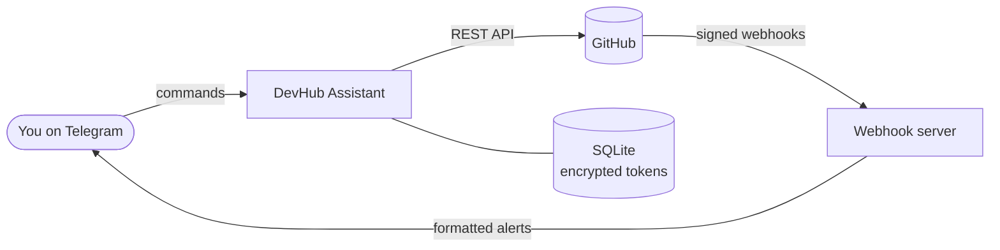

<div align="center">


<br/>

# DevHub Assistant

### GitHub, right where you chat.

A Telegram bot built for developers. Explore profiles and repositories, ship issues and gists,
and get live alerts for commits, pull requests and CI, without ever leaving the conversation.

<br/>

[](http://t.me/DevHubAssist_bot/)
[](http://t.me/DevHubAssist_bot/)
[](https://docs.github.com/en/rest)
[](LICENSE)

<br/>

**[Features](#-features)** &nbsp;·&nbsp;
**[Preview](#-preview)** &nbsp;·&nbsp;
**[Commands](#-commands)** &nbsp;·&nbsp;
**[Quick start](#-quick-start)** &nbsp;·&nbsp;
**[Architecture](#-how-it-works)** &nbsp;·&nbsp;
**[Security](#-security)** &nbsp;·&nbsp;
**[Roadmap](#-roadmap)**

</div>

<br/>

---

<br/>

## ✨ Features

<table>
<tr>
<td width="50%" valign="top">

### 🔎 Explore
Look up any user or repository, search by keyword, browse the week's trending projects and read the latest release notes.

</td>
<td width="50%" valign="top">

### 🌱 Contribute
Find `good first issue` tasks filtered by programming language and make your first open source pull request.

</td>
</tr>
<tr>
<td width="50%" valign="top">

### 🔐 Sign in safely
Login uses GitHub **Device Flow**. You type a short code on github.com, and your token never travels through the chat.

</td>
<td width="50%" valign="top">

### 🛠 Create from chat
Spin up repositories with a guided wizard, open issues, and turn any message into a secret gist.

</td>
</tr>
<tr>
<td width="50%" valign="top">

### 👀 Live alerts
Watch a repo and get commits, issues, PRs, stars, forks, releases and CI results the moment they happen. Works in team groups too.

</td>
<td width="50%" valign="top">

### 📰 Daily digest
A calm summary of the last 24 hours across your repositories, on demand or delivered every morning.

</td>
</tr>
</table>

<br/>

---

<br/>

## 💬 Preview

```text
You        /repo torvalds/linux

DevHub     📦 torvalds/linux
           📝 Linux kernel source tree

           ⭐ 190k   🍴 57k   🐞 open issues
           💻 C      📄 NOASSERTION
           🕒 Updated: today
           🔗 github.com/torvalds/linux
```

```text
DevHub     📌 my-org/api · 2 new commit(s) on main by alice
           • a1b2c3d fix: handle empty payload
           • d4e5f6a feat: add rate limiter

DevHub     🟣 PR merged in my-org/api by bob
           #128 Improve error messages

DevHub     ✅ CI build success in my-org/api
           Branch: main · details
```

<sub>Illustrative output. Numbers are examples.</sub>

<br/>

---

<br/>

## 🤖 Commands

### Explore &nbsp;<sub>no login required</sub>

| Command | What it does |
|:--|:--|
| `/user <username>` | Profile info: bio, location, repos, followers |
| `/repo <owner/name>` | Stars, forks, language, license, last update |
| `/search <query>` | Search repositories, sorted by stars |
| `/trending [language]` | Most starred new repos of the past 7 days |
| `/release <owner/name>` | Latest release and its notes |
| `/issues <owner/name>` | Open issues |
| `/prs <owner/name>` | Open pull requests |
| `/goodfirst [language]` | Beginner friendly issues |
| `/stats <username>` | Total stars and top languages |

### Account &nbsp;<sub>after `/login`</sub>

| Command | What it does |
|:--|:--|
| `/login` · `/logout` | Connect or disconnect your GitHub account |
| `/newrepo` | Create a repository step by step, with buttons |
| `/newissue <owner/name> <title>` | Open an issue |
| `/gist` | Create a secret gist from a replied message or `/gist <text>` |
| `/star` · `/unstar <owner/name>` | Star or unstar a repository |


<br/>

## 🧭 How it works



The bot runs two things in one process: a Telegram **polling** loop that handles your commands, and a small **aiohttp** server that receives GitHub webhooks, verifies their signature and forwards them to the right chat.

<br/>

<details>
<summary><b>📁 Project structure</b></summary>

<br/>

```text
devhub-assistant/
├── bot.py               # entry point: handlers, webhook server, daily job
├── config.py            # environment variables
├── storage.py           # SQLite: encrypted tokens, watches, digest
├── github_api.py        # async wrapper over the GitHub REST API
├── webhook_server.py    # receives and verifies GitHub webhooks
├── handlers/
│   ├── basic.py         # read-only commands
│   ├── auth_write.py    # login, newrepo, newissue, gist, star
│   └── watch.py         # watch, digest, notifications
├── assets/
│   └── logo.png
├── requirements.txt
└── .env                 # never commit this
```

</details>


<br/>

## 🤝 Contributing

Contributions are welcome.

1. Fork the repository
2. Create a branch: `git checkout -b feat/my-feature`
3. Commit with [Conventional Commits](https://www.conventionalcommits.org/): `git commit -m "feat: add /branch command"`
4. Push and open a pull request

<br/>

## 📄 License

Released under the [MIT License](LICENSE).

<br/>

<div align="center">

**DevHub Assistant**
<br/>
<sub>Made for developers who live in Telegram.</sub>

</div>